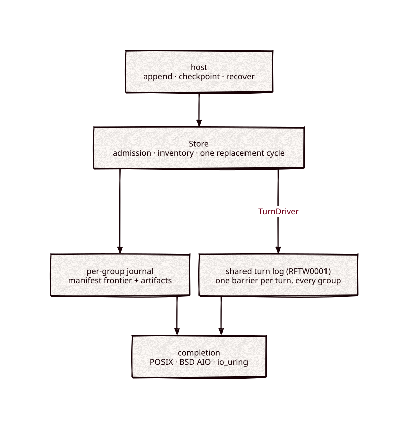

# journal

[](https://github.com/Kronuz/journal/actions/workflows/ci.yml)
[](LICENSE)


Crash-safe storage for opaque batches and checkpoints, in C++20: append a batch and
get back a durable frontier, publish immutable checkpoint generations, and recover
exactly what was acknowledged. It is the storage under
[consensus](https://github.com/Kronuz/consensus)'s Raft groups, for anyone who needs
a write-ahead log with real durability barriers.



`Store::grow_replacement(id, minimum_bundle_cap)` increases an existing protected checkpoint reservation without I/O or a new replacement identity. It returns false if the additional capacity or backend artifact bound is unavailable, preserving the reservation. Growth may follow settled application preparation, but not pending original I/O or the start of bundle preparation. `Admission::grow_replacement` preserves the same permit and ticket; durable settlement and uncertain-I/O fencing remain unchanged.

## ✨ Highlights

- **Durable means durable.** Every append returns only after its barriers, and macOS
  uses `F_FULLFSYNC`; unsupported operations fail instead of weakening the contract.
- **Fails closed.** Corruption anywhere in the acknowledged prefix stops recovery, and
  any uncertain I/O fences the journal until a fresh instance recovers.
- **Checkpoints without stalls.** Artifacts are prepared, sealed, and verified before
  the cutover, so publishing a 128 MiB checkpoint took about 64 ms in local samples.
- **Bounded disk.** Admission reserves the worst-case footprint before any write, and
  reclamation removes only files it proves it owns.
- **One barrier for many groups.** The shared turn log persists every group on a core
  with one data barrier per turn.
- **Async-ready.** Every mutation is a resumable state machine that
  [completion](https://github.com/Kronuz/completion)'s BSD AIO and Linux io_uring
  backends can drive off the owner's thread.

## 📦 Installation

Requires a C++20 compiler and CMake 3.16 or newer; it fetches
[completion](https://github.com/Kronuz/completion) at a pinned commit. CI builds it
on Linux (x86_64, arm64), macOS (arm64, x86_64), and FreeBSD, plus ASan, UBSan, and
TSan builds.

```cmake
include(FetchContent)
FetchContent_Declare(journal
  GIT_REPOSITORY https://github.com/Kronuz/journal.git
  GIT_TAG        main)
FetchContent_MakeAvailable(journal)

target_link_libraries(my_app PRIVATE journal::journal)
```

## 🚀 Quick start

Create a store, append, then recover it after a restart:

```cpp
#include "journal/journal.h"
#include "completion/posix.h"

#include <iostream>

namespace j = kronuz::journal;

int main() {
	j::PosixIO io("store");                  // an existing, dedicated directory
	j::Journal journal(io, 1024 * 1024);     // batches of at most 1 MiB

	j::Identity identity{};                  // 128 bits, unique per store
	identity[0] = 'S';
	journal.create(identity);
	auto frontier = journal.append_batch("hello");   // durable on return
	std::cout << "sequence " << frontier.sequence << '\n';
}
```

Reopening uses `recover` instead of `create`; the callback sees each batch once:

```cpp
journal.recover([](auto, std::string_view batch) { std::cout << batch << '\n'; });
```

[`examples/demo.cc`](examples/demo.cc) is a small command-line tool around these calls.

## 🎯 When to use it

- ✅ A log of opaque records that must survive power loss: Raft logs, write-ahead
  logs, state machines with snapshots.
- ✅ Many small groups on one machine: the shared turn log amortizes the barrier.
- ❌ A key-value store or queryable data: records are opaque and replayed in order.
- ❌ Network filesystems or storage that ignores flushes: the durability model assumes
  a local filesystem that honors `fsync` and atomic rename.

## 📚 Documentation

- [ARCHITECTURE.md](ARCHITECTURE.md): the contract, checkpoints, reclamation,
  admission, `Store`, completion-driven operations, the turn log, and the durability
  model.
- [docs/MEASUREMENTS.md](docs/MEASUREMENTS.md): append, checkpoint, and reclamation
  measurements, and the qualification log.
- [AGENTS.md](AGENTS.md): repository map and the rules for changing storage code.

## 🛠️ Building and testing

```sh
cmake -S . -B build -DCMAKE_BUILD_TYPE=Release
cmake --build build -j4
ctest --test-dir build --output-on-failure
```

The benchmarks (`journal_bench`, `journal_checkpoint_bench`, `journal_reclaim_bench`,
`journal_turn_bench`) run from the repository root and write under `.scratch/`.

## 🤝 Contributing

Issues and pull requests are welcome. Storage changes need fault schedules for every
new primitive; read [AGENTS.md](AGENTS.md) first. CI must pass on every platform.

## 📄 License

MIT, Copyright (c) 2026 Germán Méndez Bravo. See [LICENSE](LICENSE).

## Shared reservation accounting

Journal delegates checked resource arithmetic and committed/reserved counters to `allocators::resources`. Its public storage permits, protected control/replacement pools and slot limits remain Journal policy. Permits retain their admission owner through completion, and known-unstarted cancellation refunds explicitly. Started or uncertain abandonment fences admission and preserves reserved debt. No disk format or I/O backend changes with this extraction.

CRC-32C is [`crc32c::crc32c`](https://github.com/Kronuz/crc32c), header-only with no dependencies; `journal::crc32c` forwards to it and `journal::Checksum` is its `Crc32c`. Persisted bytes are unchanged, and `test/fixtures/crc32c` holds a journal directory and a turn log written by the earlier byte-table CRC that must keep verifying.

The shared aliases preserve C++ source names, but their canonical type identities and some internal object layouts change. Rebuild C++ dependents together; do not mix precompiled objects from before and after this extraction. Persisted formats are unchanged by these allocation/accounting moves.
